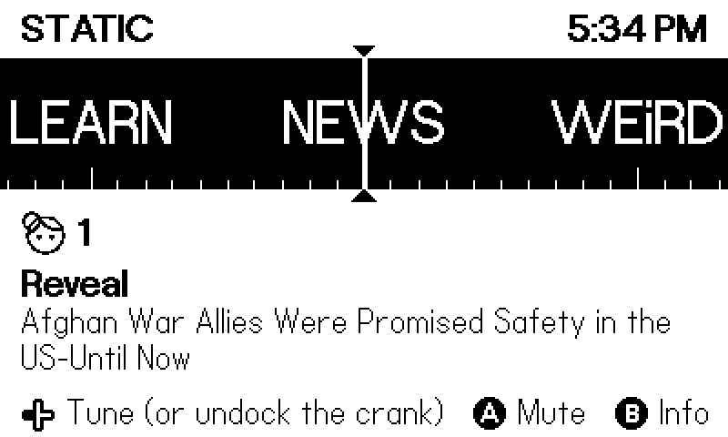
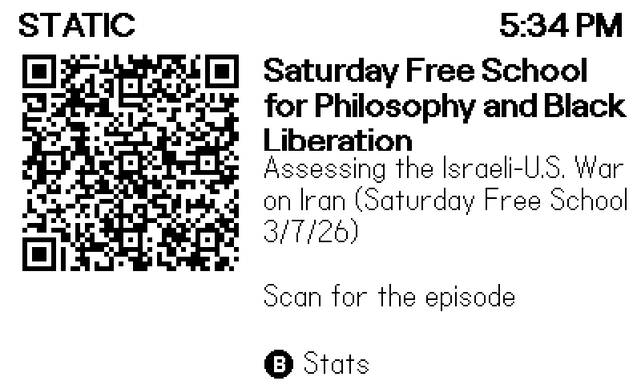

# Static for Playdate (preview)

[Static](https://staticradio.app) is a radio made of independent podcasts: every
station plays one shared live timeline, so everyone tuned in hears the same
moment. This puts it on a [Playdate](https://play.date). The crank is the dial.

**Static's website: [staticradio.app](https://staticradio.app)**, where you can
also listen in your browser and get the phone apps.

 

**This is a preview for testers.** We don't own a Playdate, so we can't see how
it runs on real hardware. The app starts with a two-minute test that measures
exactly that and, if you agree, sends us the numbers. Then the radio unlocks.

0.1.1 fixes two crashes we found while tuning in the 0.1.0 preview. We've only
confirmed that in the Simulator so far, so reports from real Playdates are very
welcome. See
[issue #1](https://github.com/madewith-bestpractice/static-playdate/issues/1).

## Install

1. Download `Static-<version>.pdx.zip` from
   [Releases](https://github.com/madewith-bestpractice/static-playdate/releases/latest).
2. Sign in at [play.date/account/sideload](https://play.date/account/sideload/)
   and upload the zip.
3. On your Playdate, open the **Game Library** (or **Settings > Games** on
   older system versions) and refresh the list, then download and launch
   **Static**. It appears under Sideloaded.

(Or copy the unzipped `Static.pdx` into the `Games` folder over USB, using
**Settings > System > Reboot to Data Disk**.)

The first time Static goes online, your Playdate asks whether it may use the
internet. Static streams each episode straight from that show's own host, so
it needs to reach many different servers. Please choose **Allow**.

## The test

It takes about two minutes and plays nothing aloud:

1. **Decoding speed** for MP3, HE-AAC and AAC-LC, from short clips that ship
   with the app, so every Playdate decodes the same bytes.
2. **Today's schedule**, fetched from `data.staticradio.app`.
3. **Live streaming:** 256 KB from the live episode on four stations, measuring
   the time to the first byte (through every redirect) and the speed.

Then the results screen offers **Ⓐ Send results and start the radio** or
**Ⓑ Start without sending**. You can run it again from the system menu
(**rerun test**).

### What gets sent

Only if you press Ⓐ (or **send report** in the system menu), as one anonymous
event to `staticradio.app/api/event`:

- A random ID made on your Playdate (`pd-` plus 16 hex digits). It isn't tied
  to your Playdate account, serial number or anything else.
- The app version, the Playdate OS version, the battery percentage.
- Decoding CPU use per format, schedule fetch time and size, and per station:
  HTTP status, number of redirects, time to first byte, speed, any error.
- From the system menu's **send report**: listening stats, meaning minutes
  listened, tune times, buffer underruns, reconnects, sync corrections,
  decoding CPU per format and the app's frame rate.

If a previous run stopped unexpectedly, the intro screen says at which step,
and that step's name is sent with your next report.

While you listen, Static counts you on the station's listener count the same
way the phone apps do (a heartbeat with the same random ID), so other
listeners can see you there.

## Use

- **Turn the crank** to tune (a third of a turn per station), or press
  **left/right** on the D-pad.
- **Ⓐ** mutes. **Ⓑ** shows the episode's info with a QR code to its web page;
  press it again for stats (decoding CPU, buffer, sync drift, tune times, frame
  rate), and once more to go back to the dial.
- Under the dial, the day's listener face and the live count of everyone on
  that station (phones, web and Playdates), as on the phone.
- The system menu has **send report** and **rerun test**.

Static turns off the three-minute auto-lock while the radio is on, because the
Playdate pauses apps when it locks. Locking it yourself stops the sound.

Stations land on the live position, the same moment phones and the web player
are hearing. Tuning takes a second or two; Static resolves the next episode and
the neighboring stations in the background so later tunes are quicker.

## What it can play

MP3, AAC (including HE-AAC, which SHEILA uses) in MP4/M4A, and 16-bit WAV,
mixed to mono for the Playdate's speaker. MP4 files need their index
downloaded first; for SHEILA's three-hour shows that's about 1 MB, so tuning
there takes longer. Decoding is fixed point (Helix), so it doesn't need the
FPU.

## Build

You need the [Playdate SDK](https://play.date/dev/) (3.1 or later) and the
[Arm GNU toolchain](https://developer.arm.com/downloads/-/arm-gnu-toolchain-downloads)
(`arm-none-eabi-gcc` on your `PATH`).

```sh
make            # simulator + device, into Static.pdx
make pdc        # simulator only
make dist       # Static-<version>.pdx.zip for sideloading
```

Source map: `src/net.c` is HTTP/1.1 over the SDK's TLS sockets (the SDK's own
HTTP layer follows redirects in the background and mixes up connections, so
we don't use it), `src/player.c` tunes and keeps sync, `src/dec.c` wraps the
decoders, `src/bench.c` is the test and `src/report.c` the reports.

## Thanks

We don't own a Playdate, so this port exists because of the people who do.
Thanks to everyone who ran the test build and sent in their numbers, which is
how we know where it stands on real hardware, and to
[@ghalfacree](https://github.com/ghalfacree) for the first detailed report
from a real device.

## License

MIT for this project's code, see [LICENSE](LICENSE). The Helix MP3/AAC decoders
in `src/third_party/helix` are RealNetworks' RPSL/RCSL (license files are in
each directory). The fonts in `Source/fonts` are Panic's Playdate fonts,
CC BY 4.0. Playdate is a trademark of Panic Inc.; this project isn't made or
endorsed by Panic.
